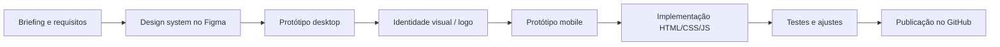

# 01 · Visão geral

[← Sumário](README.md) · [Próximo: Arquitetura →](02-arquitetura.md)

## Sumário
- [Contexto](#contexto)
- [Objetivo](#objetivo)
- [Equipe](#equipe)
- [Escopo](#escopo)
- [Requisitos funcionais](#requisitos-funcionais)
- [Requisitos não funcionais](#requisitos-não-funcionais)
- [Etapas do desenvolvimento](#etapas-do-desenvolvimento)

## Contexto

| Item | Descrição |
|------|-----------|
| Disciplina | Projeto Integrador — Engenharia da Computação |
| Cliente (fictício) | Super Security — Vigilância e Segurança Privada Ltda. |
| Localização | Recife – PE (atuação na Região Metropolitana) |
| Produto | Landing page institucional *one-page* |
| Protótipo | [Figma — Super Security Landing Page](https://www.figma.com/design/YsVEajfnVygWz5KiBz4925) |

## Objetivo

Projetar e implementar o site institucional de uma empresa de segurança privada,
com foco em **captação de orçamentos**: o visitante entende os serviços, confia na
empresa (autorização da Polícia Federal, atendimento 24h) e entra em contato pelo
formulário ou pelo WhatsApp.

## Equipe

Grupo 09:

| Integrante | Matrícula |
|------------|-----------|
| Almir de Lima Felix dos Santos | 01878487 |
| Breno Victor Florencio da Silva Marques | 01894104 |
| Davi Lopes da Silva Marques | 01902324 |
| Guilherme Anildo de Oliveira da Silva | 01878051 |
| Kauã Gabriel Ferreira Sobral | 01947077 |
| Saulo Guimarães de Souza Dantas | 01907485 |

## Escopo

**Incluído**
- Página única com 8 seções: barra institucional, cabeçalho, hero, sobre nós,
  serviços, diferenciais, orçamento e rodapé.
- Versões para desktop (1440px), tablet e celular (390px).
- Formulário de orçamento com validação e envio para o WhatsApp comercial.
- Mapa esquemático da área de cobertura (radar e mapa do formulário).

**Fora do escopo**
- Back-end próprio, banco de dados ou painel administrativo.
- Múltiplas páginas, blog ou área do cliente.
- Dados reais da empresa (telefones, e-mail e alvará são fictícios).

## Requisitos funcionais

| ID | Requisito | Onde está |
|----|-----------|-----------|
| RF01 | Exibir menu com links para as seções Início, Sobre Nós, Serviços, Diferenciais e Contato | `index.html` §01 |
| RF02 | Rolar suavemente até a seção ao clicar num link do menu | `styles.css` §2 (`scroll-behavior`) |
| RF03 | Destacar no menu a seção visível | `main.js` §3 |
| RF04 | Oferecer menu "hambúrguer" em telas pequenas | `index.html` §01b · `main.js` §2 |
| RF05 | Apresentar os 5 serviços com descrição | `index.html` §04 |
| RF06 | Pré-selecionar o serviço no formulário ao clicar nele | `main.js` §4.3 |
| RF07 | Formulário com nome, telefone, e-mail, segmento, serviço e detalhes | `index.html` §06 |
| RF08 | Validar campos obrigatórios e mostrar mensagens de erro | `main.js` §4.4–4.5 |
| RF09 | Aplicar máscara de telefone brasileiro | `main.js` §4.2 |
| RF10 | Abrir o WhatsApp comercial com o resumo da solicitação | `main.js` §4.8 |
| RF11 | Enviar resumo por e-mail (configurável) | `main.js` §4.7 |
| RF12 | Botão flutuante de WhatsApp sempre visível | `index.html` §08 |
| RF13 | Links de telefone clicáveis (`tel:`) para ligação direta | `index.html` |

## Requisitos não funcionais

| ID | Requisito | Como foi atendido |
|----|-----------|-------------------|
| RNF01 | Responsividade de 320px a 1920px | Layout flexível + 3 breakpoints ([05-css](05-css.md#breakpoints)) |
| RNF02 | Acessibilidade WCAG 2.1 nível AA | Contraste, foco visível, ARIA, navegação por teclado ([08](08-acessibilidade.md)) |
| RNF03 | Sem dependências de build | HTML, CSS e JS puros; abre direto no navegador |
| RNF04 | Desempenho | Imagens vetoriais (SVG), um único CSS e um único JS, `defer` no script |
| RNF05 | Manutenibilidade | Tokens em variáveis CSS, classes BEM, código comentado e indexado |
| RNF06 | Fidelidade ao protótipo | Medidas e estilos extraídos do Figma ([03](03-design-system.md)) |
| RNF07 | Compatibilidade | Navegadores atuais (Chrome, Edge, Firefox, Safari) |

## Etapas do desenvolvimento

1. **Briefing** — definição do público, seções e conteúdo.
2. **Design system** — tokens de cor, tipografia e componentes no Figma.
3. **Protótipo desktop** — frame de 1440px com as 8 seções.
4. **Identidade visual** — símbolo (escudo com monograma "S") e assinatura.
5. **Protótipo mobile** — frame de 390px e estado de menu aberto.
6. **Implementação** — tradução do protótipo para código, usando o Dev Mode como referência de medidas.
7. **Testes** — ver [10-testes](10-testes.md).
8. **Publicação** — repositório no GitHub (e opcionalmente GitHub Pages).
