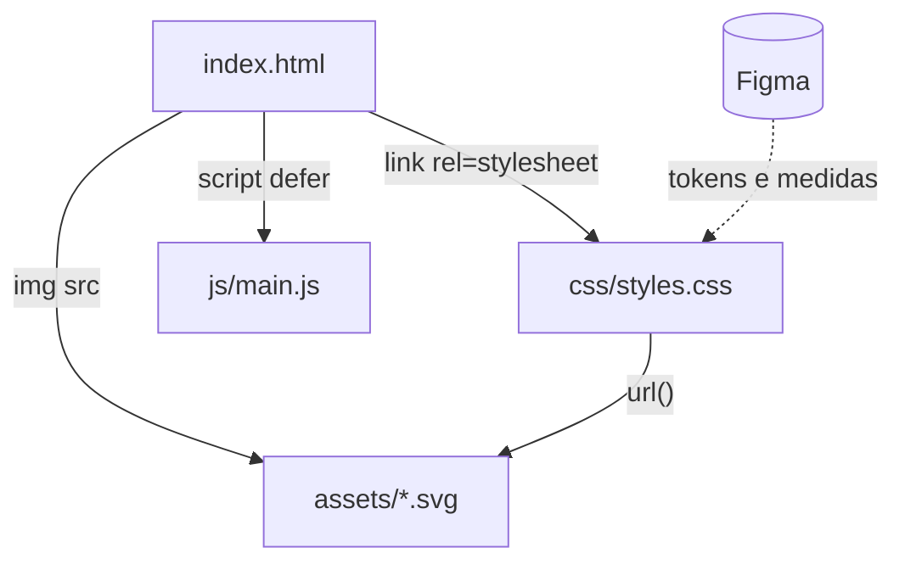
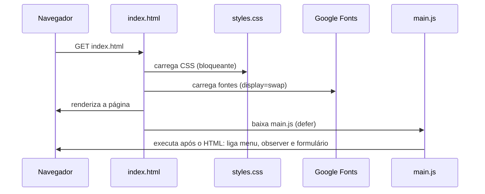

# 02 · Arquitetura

[← Visão geral](01-visao-geral.md) · [Sumário](README.md) · [Próximo: Design system →](03-design-system.md)

## Sumário
- [Tecnologias](#tecnologias)
- [Estrutura de pastas](#estrutura-de-pastas)
- [Assets](#assets)
- [Como as partes se conectam](#como-as-partes-se-conectam)
- [Fluxo de carregamento](#fluxo-de-carregamento)
- [Decisões técnicas](#decisões-técnicas)

## Tecnologias

| Camada | Tecnologia | Motivo |
|--------|-----------|--------|
| Estrutura | HTML5 semântico | Acessibilidade e SEO sem framework |
| Estilo | CSS3 (variáveis, Flexbox, Grid, `aspect-ratio`) | Responsividade nativa, sem pré-processador |
| Comportamento | JavaScript ES5 puro | Roda em qualquer navegador sem build |
| Fontes | Google Fonts (Inter, Newsreader, JetBrains Mono) | Mesmas fontes do protótipo |
| Imagens | SVG | Leve e nítido em qualquer resolução |
| Protótipo | Figma | Design system e telas desktop/mobile |
| Versionamento | Git + GitHub | Histórico e colaboração |

## Estrutura de pastas

```
super-security/
├── index.html                 Página única com as 8 seções
├── README.md                  Apresentação do projeto
├── css/
│   └── styles.css             Tokens, componentes, seções e responsivo
├── js/
│   └── main.js                Menu, navegação ativa, máscara e formulário
├── assets/
│   ├── icons/                 Ícones de linha 24px (nome-cor.svg)
│   ├── img/                   Símbolo da marca, favicon e mapa-base
│   └── radar/                 Camadas do radar de cobertura
└── docs/                      Esta documentação
```

## Assets

### `assets/icons/` — ícones de linha

Padrão de nome: `<ícone>-<cor>.svg`. Todos têm 24×24, traço de 2px.

| Arquivo | Onde aparece |
|---------|--------------|
| `arrow-right-navy.svg` | Botões dourados, setas da lista de serviços |
| `arrow-right-branco.svg` | Itens do menu mobile |
| `phone-branco.svg` | Botão de emergência, barra fixa do celular |
| `chat-navy.svg` | Botão do WhatsApp no formulário e FAB |
| `mail-cinza.svg` | Nota abaixo do botão de envio |
| `award-dourado.svg` | Selo da Polícia Federal nos indicadores |
| `chevron-down-escuro.svg` | Seta dos campos `<select>` (via CSS) |
| `shield-navy.svg` | Serviço 01 — Vigilância |
| `users-navy.svg` | Serviço 02 — Eventos |
| `truck-navy.svg` | Serviço 03 — Escolta |
| `camera-navy.svg` | Serviço 04 — Monitoramento |
| `door-navy.svg` | Serviço 05 — Portaria |

### `assets/img/`

| Arquivo | Descrição |
|---------|-----------|
| `simbolo-dourado.svg` | Símbolo da marca para fundos escuros (header, footer, menu) |
| `simbolo-navy.svg` | Símbolo para fundos claros (reserva) |
| `favicon.svg` | Ícone da aba do navegador |
| `mapa-recife-rmr.svg` | Mapa-base 930×713 da Região Metropolitana (ver [07](07-mapa-e-radar.md)) |

### `assets/radar/`

| Arquivo | Camada |
|---------|--------|
| `anel-15km-graduacao.svg` | Anel externo de 15 km com marcações a cada 5° |
| `anel-tracejado.svg` | Anel tracejado reutilizado para 5 km e 10 km |
| `vinheta.svg` | Escurecimento nas bordas do círculo |
| `varredura.svg` | Setor dourado que gira (animação CSS) |

## Como as partes se conectam



- O **HTML** só referencia classes; nenhum estilo inline, exceto as posições
  calculadas dos pinos do mapa (`style="left:…;top:…"`).
- O **CSS** concentra todo o visual; o JavaScript nunca define cores ou tamanhos,
  apenas liga/desliga classes (`.is-active`, `.has-error`) e atributos (`hidden`, `aria-*`).
- O **JS** depende de ids e classes do HTML listados em [06-javascript](06-javascript.md#dependências-do-html).

## Fluxo de carregamento



Com `display=swap`, o texto aparece imediatamente com a fonte do sistema e troca
para a fonte do design quando ela termina de carregar.

## Decisões técnicas

| Decisão | Alternativa considerada | Justificativa |
|---------|------------------------|---------------|
| HTML/CSS/JS sem framework | React, Tailwind | Projeto pequeno, sem estado complexo; abre sem instalação |
| Uma página só (*one-page*) | Várias páginas | Pedido do briefing; navegação por âncoras |
| Variáveis CSS como tokens | Valores fixos | Mudar uma cor em um lugar atualiza o site inteiro |
| BEM simplificado | Classes utilitárias | Nomes legíveis e ligados ao componente do Figma |
| Desktop primeiro + `max-width` | Mobile primeiro | Protótipo principal foi o de 1440px |
| Posições do mapa em % | Coordenadas em px | O radar e o mapa encolhem sem perder o alinhamento |
| Mapa desenhado a partir de coordenadas | Imagem desenhada à mão | Rios, vias e litoral nas posições geográficas aproximadas |
| WhatsApp via `wa.me` | API do WhatsApp Business | Não exige conta nem servidor |
| E-mail via FormSubmit (desligado) | Back-end próprio | Funciona em hospedagem estática (GitHub Pages) |
| IIFE no `main.js` | Módulos ES | Evita variáveis globais e roda abrindo o arquivo direto |
