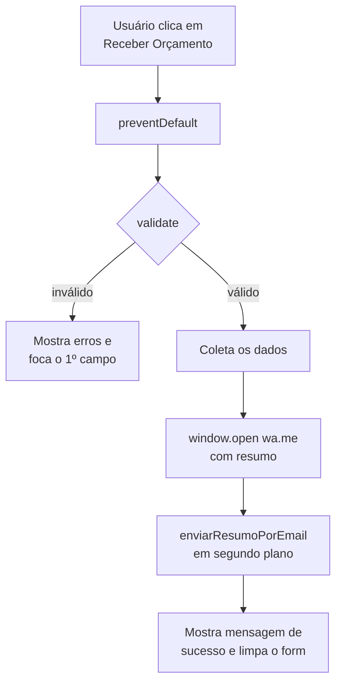

# 06 · JavaScript (`js/main.js`)

[← CSS](05-css.md) · [Sumário](README.md) · [Próximo: Mapa e radar →](07-mapa-e-radar.md)

O script não depende de bibliotecas. É carregado com `defer` (executa depois que o
HTML é lido) e todo o código fica dentro de uma IIFE com `"use strict"`, sem
criar variáveis globais. As seções abaixo têm a mesma numeração dos comentários
do arquivo.

## Sumário
- [1. Configuração](#1-configuração)
- [2. Menu mobile](#2-menu-mobile)
- [3. Navegação ativa](#3-navegação-ativa)
- [4. Formulário](#4-formulário)
  - [4.1 Referências](#41-referências)
  - [4.2 Máscara de telefone](#42-máscara-de-telefone)
  - [4.3 Pré-seleção do serviço](#43-pré-seleção-do-serviço)
  - [4.4 Regras de validação](#44-regras-de-validação)
  - [4.5 validate()](#45-validate)
  - [4.6 resumo(d)](#46-resumod)
  - [4.7 enviarResumoPorEmail(dados)](#47-enviarresumoporemaildados)
  - [4.8 Envio do formulário](#48-envio-do-formulário)
- [Dependências do HTML](#dependências-do-html)
- [Eventos registrados](#eventos-registrados)

---

## 1. Configuração

| Constante | Tipo | Valor atual | Descrição |
|-----------|------|-------------|-----------|
| `WHATSAPP` | `string` | `"5581999990000"` | Número do WhatsApp comercial: `55` + DDD + número, só dígitos |
| `EMAIL_COMERCIAL` | `string` | `"contato@supersecurity.com.br"` | Destino do resumo por e-mail |
| `ENVIAR_EMAIL` | `boolean` | `false` | Liga o envio por e-mail ([como ativar](09-guia-de-manutencao.md#ativar-o-envio-por-e-mail)) |

> Os valores atuais são fictícios.

## 2. Menu mobile

Controla o painel `#mobile-menu`, visível só em telas ≤ 1024px.

### `openMenu()`
Abre o menu.

| Ação | Motivo |
|------|--------|
| `menu.hidden = false` | Mostra o painel |
| `aria-expanded="true"` no `.menu-toggle` | Informa leitores de tela |
| `body.style.overflow = "hidden"` | Impede a página de rolar por trás |
| `closeBtn.focus()` | Coloca o foco dentro do menu |

### `closeMenu()`
Faz o inverso e devolve o foco ao botão hambúrguer.

### Gatilhos

| Evento | Elemento | Resultado |
|--------|----------|-----------|
| `click` | `.menu-toggle` | `openMenu()` |
| `click` | `.menu-close` | `closeMenu()` |
| `click` em qualquer `<a>` | `#mobile-menu` | `closeMenu()` (e o navegador rola até a seção) |
| `keydown` `Escape` | `document` | `closeMenu()` se o menu estiver aberto |

## 3. Navegação ativa

Um `IntersectionObserver` observa as seções `#inicio`, `#sobre`, `#servicos`,
`#diferenciais` e `#contato`. Quando uma delas cruza a faixa central da tela, o
link correspondente em `.main-nav` recebe a classe `.is-active` (sublinhado dourado).

```js
rootMargin: "-45% 0px -50% 0px"
```

Ou seja, só conta como "visível" a seção que passa por uma faixa de ~5% da altura
no meio da tela. Em navegadores sem `IntersectionObserver` o recurso é ignorado
(o primeiro link continua marcado).

## 4. Formulário

### 4.1 Referências

| Variável | Elemento |
|----------|----------|
| `form` | `#form-orcamento` |
| `tel` | `#telefone` |
| `servicoSelect` | `#servico` |
| `status` | `.form__status` (mensagem de sucesso) |

### 4.2 Máscara de telefone

Escuta o evento `input` do campo de telefone, remove tudo que não é número,
limita a 11 dígitos e formata:

| Dígitos digitados | Resultado |
|-------------------|-----------|
| `81` | `(81` |
| `8130000000` (10) | `(81) 3000-0000` |
| `81999990000` (11) | `(81) 9 9999-0000` |

### 4.3 Pré-seleção do serviço

Todos os elementos com `data-servico` (os itens da lista de serviços) recebem um
`click` que copia o valor para o `<select id="servico">`. Como o link também aponta
para `#contato`, o usuário chega ao formulário com o serviço já escolhido.

> O texto do `data-servico` deve ser **idêntico** ao de uma `<option>` do select.

### 4.4 Regras de validação

Objeto `rules`: a chave é o `name` do campo e o valor é uma função que retorna
`true` (válido) ou a mensagem de erro.

| Campo | Regra | Mensagem |
|-------|-------|----------|
| `nome` | ≥ 3 caracteres (sem espaços nas pontas) | Informe seu nome completo. |
| `telefone` | ≥ 10 dígitos | Informe um telefone com DDD. |
| `email` | formato `algo@dominio.ext` | Informe um e-mail válido. |
| `segmento` | opção escolhida | Selecione o segmento. |
| `servico` | opção escolhida | Selecione o serviço de interesse. |

`detalhes` é opcional e não tem regra. Para adicionar uma regra, basta incluir
uma nova chave em `rules` com o `name` do campo.

### 4.5 validate()

```js
/** @returns {boolean} true se todos os campos forem válidos */
function validate()
```

Percorre `rules`. Para cada campo:

| Resultado | Efeito no HTML |
|-----------|----------------|
| válido | remove `.has-error`, remove `aria-invalid`, limpa `.field__error` |
| inválido | adiciona `.has-error` (borda vermelha), `aria-invalid="true"`, escreve a mensagem |

### 4.6 resumo(d)

```js
/**
 * @param {{nome, telefone, email, segmento, servico, detalhes?}} d
 * @returns {string}
 */
function resumo(d)
```

Monta o texto enviado ao WhatsApp. Exemplo de saída:

```
Olá! Gostaria de um orçamento de segurança.

Nome: Maria da Silva
Telefone: (81) 9 9999-0000
E-mail: maria@empresa.com.br
Segmento: Condomínio Residencial
Serviço: Portaria e Controle de Acesso
Detalhes: 2 portarias, 120 unidades
```

A linha "Detalhes" só aparece se o campo foi preenchido.

### 4.7 enviarResumoPorEmail(dados)

```js
/**
 * @param {Object} dados  mesmo objeto de resumo()
 * @returns {Promise<void>}
 */
function enviarResumoPorEmail(dados)
```

- Se `ENVIAR_EMAIL` for `false`, retorna sem fazer nada.
- Senão, faz `POST` em `https://formsubmit.co/ajax/<EMAIL_COMERCIAL>` com os dados em
  JSON e o assunto `Novo orçamento — <serviço>`.
- Erros de rede são ignorados para não atrapalhar o fluxo (o WhatsApp já abriu).

### 4.8 Envio do formulário



O `window.open` é chamado **sincronamente** dentro do clique; se fosse depois de
uma operação assíncrona, o navegador poderia bloquear como pop-up.

URL gerada: `https://wa.me/<WHATSAPP>?text=<resumo codificado com encodeURIComponent>`

## Dependências do HTML

O script espera encontrar estes elementos. Se algum for removido ou renomeado,
ajuste o `main.js`.

| Seletor | Seção do script |
|---------|-----------------|
| `.menu-toggle` | §2 |
| `#mobile-menu` | §2 |
| `.menu-close` | §2 |
| `.main-nav a` | §3 |
| `#inicio` `#sobre` `#servicos` `#diferenciais` `#contato` | §3 |
| `#form-orcamento` | §4 |
| `#telefone` `#servico` | §4.2, §4.3 |
| `.form__status` | §4.8 |
| `[data-servico]` | §4.3 |
| campos com `name` nome, telefone, email, segmento, servico, detalhes | §4.4–4.8 |
| `.field` > `.field__error` | §4.5 |

## Eventos registrados

| Evento | Alvo | Função |
|--------|------|--------|
| `click` | `.menu-toggle` | `openMenu` |
| `click` | `.menu-close` | `closeMenu` |
| `click` | `#mobile-menu` (links) | `closeMenu` |
| `keydown` | `document` | fecha o menu com ESC |
| `IntersectionObserver` | 5 seções | marca `.is-active` |
| `input` | `#telefone` | máscara |
| `click` | `[data-servico]` | pré-seleção |
| `submit` | `#form-orcamento` | validação e envio |
